  <picture>
    <source media="(max-width: 600px)" srcset="./assets/banner-mobile.svg" />
    
  </picture>

<h3 align="center">AI Engineer</h3>

  LLM agents and RAG systems that answer from real data 
  and say so when the answer isn't there.

  <samp>langgraph &nbsp;·&nbsp; rag &nbsp;·&nbsp; computer vision &nbsp;·&nbsp; open source</samp>

  
  

### 🧠 LLM agents & RAG

- **[context-sieve](https://github.com/Emrecangok/context-sieve)** — Decides, message by message, what stays in a LangGraph agent's context: keep, pin, shorten, summarize or drop. Removed messages are archived and can be restored.

- **[DocChat](https://github.com/Emrecangok/doc_chatbot)** — Agentic RAG chatbot for your own PDF, Word, PowerPoint and Excel files. Grades what it retrieves, rewrites the query when nothing fits, and cites file and page.

- **[GaziMind](https://github.com/Emrecangok/university-regulations-rag)** — RAG assistant for Gazi University regulations. Routes the question, grades retrieved articles, rewrites student wording into regulation language, and falls back instead of guessing.

### 💼 Experience

- **AI Engineer · Politus Analytics** &nbsp;07/2025 – 05/2026
  - Built an LLM assistant that makes a brand analytics dashboard queryable in natural language, with LangGraph multi-step agent flows and an intent classification layer.
  - Brought five analytics capabilities into one chat: sentiment analysis, consumer journey, brand health, brand value and root cause.
  - Used tool calling and prompt engineering so the model reads structured API data correctly; reduced hallucination and improved TR/EN answer quality.
  - Built a RAG pipeline over analytics reports and metric documentation to ground the assistant's answers.

- **Summer Intern · Nokia** &nbsp;07/2024 – 08/2024
  - Analyzed data from network devices and wrote scripts to process it more effectively.
  - Built data analysis and automation tools to speed up internal processes.

### 🎓 Research & teams

- **Turkish social media NER** — Graduation project, Gazi University. Fine-tuned a BERT-based NER model on a self-built dataset of 5,773 TR/EN tweets labeled in IOB2 across 9 entity types, focusing on PRODUCT vs ORGANIZATION. Wrote the annotation guidelines and a targeted collection strategy that raised PRODUCT frequency to 15.32%.

- **Gazi Vision · Teknofest AI in Aviation 2025** — Founded and captained the team. Worked on object detection with YOLO and visual position estimation with SIFT, ORB and Kalman filters.

### 🎮 Side project

- **[Sheep Gate](https://play.google.com/store/apps/details?id=com.emgo.sheepgate)** — A casual mobile game I built as a hobby and published on Google Play: open the gate for the sheep, keep the lambs out. Progress stays on the device; no account needed.

  

### 🌱 Earlier projects

- **Computer vision:** [Face Mask Detection (CNN)](https://github.com/Emrecangok/Face-Mask-Detection-Classsifier-using-CNN) · [Traffic Sign Recognition (CNN)](https://github.com/Emrecangok/Traffic-Signs-Recognition-with-CNN) · [Color Detection (OpenCV)](https://github.com/Emrecangok/detecting-color-with-python-opencv)
- **Algorithms:** [Euclidean Algorithm (C)](https://github.com/Emrecangok/Euclidean-Algorithm)

### 🛠️ Stack

  
  
  
  
  
  
  
  
  
  
  
  

